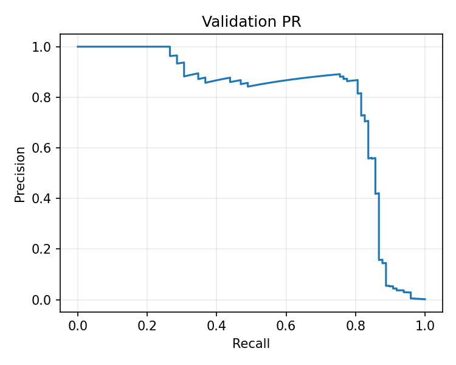
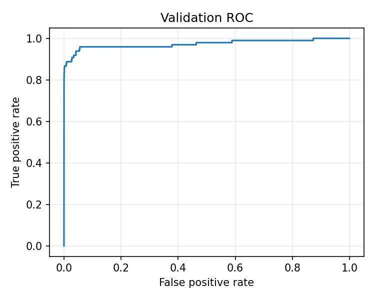

# Лабораторна робота №2

## Мета

Вибрати поріг рішення для незмінної моделі за асиметричної ціни помилок: `C = 10*FN + FP`.
Прогноз позитивний за `score >= threshold`; `precision = TP/(TP+FP)`, `recall = TP/(TP+FN)`.

## Реалізація

- `train.py` - наданий викладачем стартовий код: поділ 60/20/20, StandardScaler лише на train,
  `Linear(29,32) -> ReLU -> Linear(32,1)`, BCEWithLogitsLoss, Adam, lr=0.001, 12 епох на CPU.
- `metrics.py` - власні лічильники та пошук порога через сортування і кумулятивні суми за `O(n log n)`.
  Рівні оцінки включаються разом; серед мінімумів вартості обирається найбільший поріг.
- `checks.py` - незалежний повний перебір наборів A/B/C.
- `analyze.py` - вибір лише на validation, PR/ROC, збереження порога і тестова оцінка.

Статистики всього набору спричинили б витік інформації з validation/test у підготовку ознак.
Вхідні ознаки - V1–V28 та Amount; Time і Class не подаються моделі. Сирий Amount збережено для аналізу помилок.
ROC-AUC оцінює ранжування по всіх порогах; вона не враховує конкретну ціну FN/FP.
Через дуже малу частку шахрайства навіть невеликий FPR може дати багато FP і низьку precision.

## Запуск

Команди запускаються з кореня репозиторію в Python 3.12 через [uv](https://docs.astral.sh/uv/).
Збережені прогнози в `lab2/results` можна повторно проаналізувати без CSV і перенавчання.

```powershell
uv run --project lab2 python lab2/analyze.py --saved lab2/results
```

Для повторного навчання передайте нову або порожню теку через `--out`.
Аналіз цієї теки збереже таблиці, графіки й `report.md` поруч із прогнозами.

```powershell
python download_data.py
uv run --project lab2 python lab2/train.py --data data/creditcard/creditcard.csv --out work/lab2-rerun
uv run --project lab2 python lab2/analyze.py --saved work/lab2-rerun
```

Аналіз `lab2/results` оновлює результати нижче. Сирі дані в Git не додаються.
Перевірки окремо: `uv run --project lab2 python lab2/checks.py`.
У підготовленій локальній копії замість `uv run --project lab2 python` можна використати `.\.venv-labs\Scripts\python.exe`.

## Джерела

[Credit Card Fraud Detection](https://www.kaggle.com/datasets/mlg-ulb/creditcardfraud),
умова ЛР2, стартовий `lab2_starter.py` викладача, лекції 4–5.
Для реалізації й пояснень використано OpenAI Codex; навчальні результати обчислюються локально.

<!-- results -->

## Результати

| split | n | positives | positive_fraction |
| --- | --- | --- | --- |
| train | 170884 | 295 | 0.0017263173 |
| validation | 56961 | 98 | 0.0017204754 |
| test | 56962 | 99 | 0.0017380008 |

ROC-AUC на validation: **0.97331772**.

### Пороги на validation

| rule | threshold | TP | FP | FN | TN | C |
| --- | --- | --- | --- | --- | --- | --- |
| 0.5 | 0.5 | 71 | 9 | 27 | 56854 | 279 |
| minimum cost | 0.03119402 | 82 | 34 | 16 | 56829 | 194 |
| all negative | inf | 0 | 0 | 98 | 56863 | 980 |





### Незалежні перевірки

Набір A, обраний поріг `0.4`. Збіг точний.

| threshold | TP | FP | FN | TN | C |
| --- | --- | --- | --- | --- | --- |
| inf | 0 | 0 | 2 | 4 | 20 |
| 0.9 | 0 | 1 | 2 | 3 | 21 |
| 0.7 | 1 | 2 | 1 | 2 | 12 |
| 0.4 | 2 | 2 | 0 | 2 | 2 |
| 0.2 | 2 | 3 | 0 | 1 | 3 |
| 0.1 | 2 | 4 | 0 | 0 | 4 |

Набір B, обраний поріг `inf`. Збіг точний.

| threshold | TP | FP | FN | TN | C |
| --- | --- | --- | --- | --- | --- |
| inf | 0 | 0 | 0 | 3 | 0 |
| 0.9 | 0 | 1 | 0 | 2 | 1 |
| 0.6 | 0 | 2 | 0 | 1 | 2 |
| 0.3 | 0 | 3 | 0 | 0 | 3 |

Набір C, обраний поріг `0.8`. Збіг точний.

| threshold | TP | FP | FN | TN | C |
| --- | --- | --- | --- | --- | --- |
| inf | 0 | 0 | 2 | 11 | 20 |
| 0.8 | 1 | 0 | 1 | 11 | 10 |
| 0.5 | 2 | 10 | 0 | 1 | 10 |
| 0.2 | 2 | 11 | 0 | 0 | 11 |

A перевіряє одночасне включення однакових оцінок; B - вибір +inf за відсутності позитивних міток; C - вибір більшого порога 0.8 за однакової вартості при 0.8 і 0.5.

### Test

| class | predicted 0 | predicted 1 |
| --- | --- | --- |
| true 0 | 56820 | 43 |
| true 1 | 19 | 80 |

C = **233**, precision = **0.6504065040650406**, recall = **0.8080808080808081**. Значення `None` означає нульовий знаменник і невизначену метрику.

### Перші FP/FN за номером рядка CSV

| row | type | label | score | Amount | score_minus_threshold |
| --- | --- | --- | --- | --- | --- |
| 460 | FP | 0 | 0.19615877 | 2 | 0.16496475 |
| 2961 | FP | 0 | 0.080961101 | 2.49 | 0.049767081 |
| 10783 | FP | 0 | 0.96632707 | 89.99 | 0.93513305 |
| 13405 | FP | 0 | 0.93203175 | 89.99 | 0.90083773 |
| 13617 | FP | 0 | 0.92276222 | 89.99 | 0.8915682 |
| 10497 | FN | 1 | 0.011464376 | 3.79 | -0.019729644 |
| 52521 | FN | 1 | 0.0063731293 | 105.99 | -0.024820891 |
| 55401 | FN | 1 | 0.0056415661 | 1 | -0.025552454 |
| 91671 | FN | 1 | 0.00050042314 | 290.18 | -0.030693597 |
| 93486 | FN | 1 | 0.018351529 | 0 | -0.012842491 |

FP: Amount у межах 2.00–89.99; медіана |score - t*| = 0.8915682.

FN: Amount у межах 0.00–290.18; медіана |score - t*| = 0.024820891.

За десятьма прикладами не можна встановити причини помилок: це мала невипадкова вибірка, а Amount не входить у формулу вартості.

### Висновок

Поріг рішення змінено з 0.5 на `0.031194020062685013`. На validation вартість C змінилася з 279 до 194, FP з 9 до 34, FN з 27 до 16. На test кількість FN змінилася з 28 до 19, FP з 8 до 43, вартість C з 288 до 233. У test може бути інший склад транзакцій. Кількість позитивних і негативних прикладів з оцінками між двома порогами визначає зміни FN, FP і вартості C, тому виграш може відрізнятися.

### Середовище навчання

python: 3.12.10, numpy: 2.2.6, pandas: 2.3.3, scikit_learn: 1.7.2, torch: 2.9.0+cpu, device: cpu, torch_num_threads: 4.

Відтворення аналізу використовує збережені прогнози.
