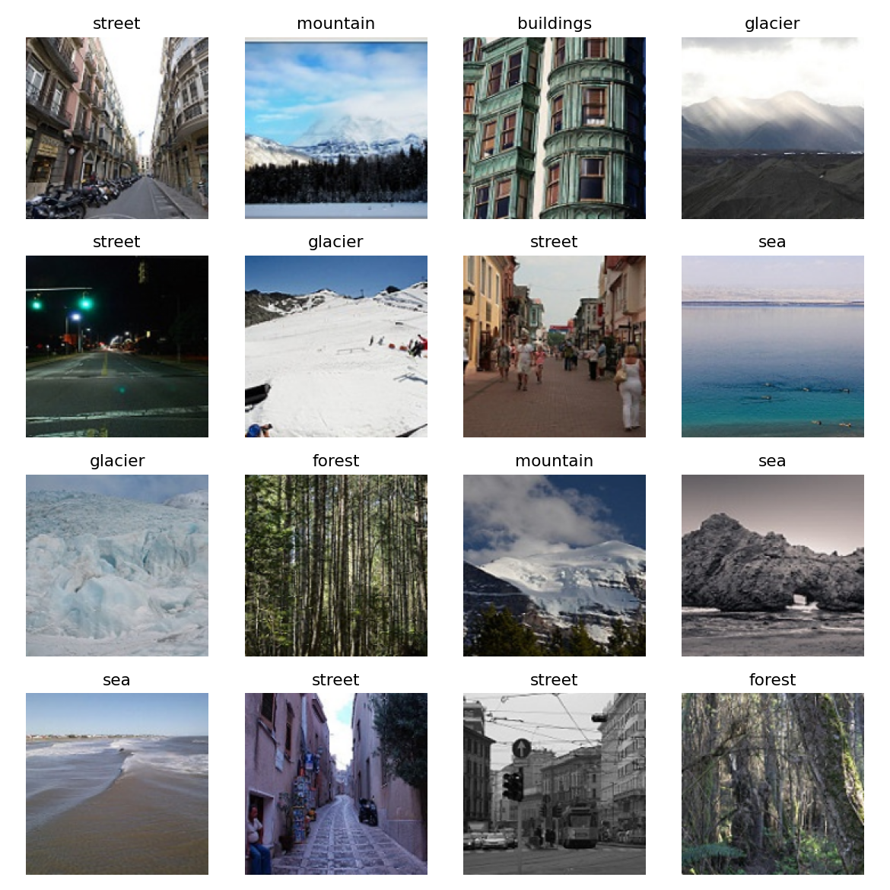
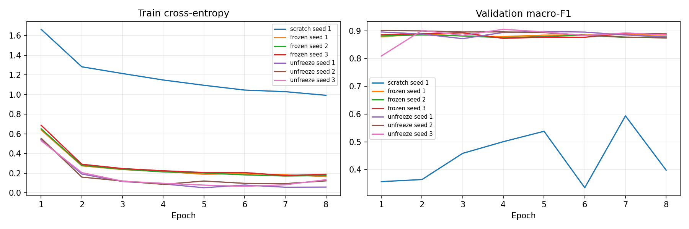
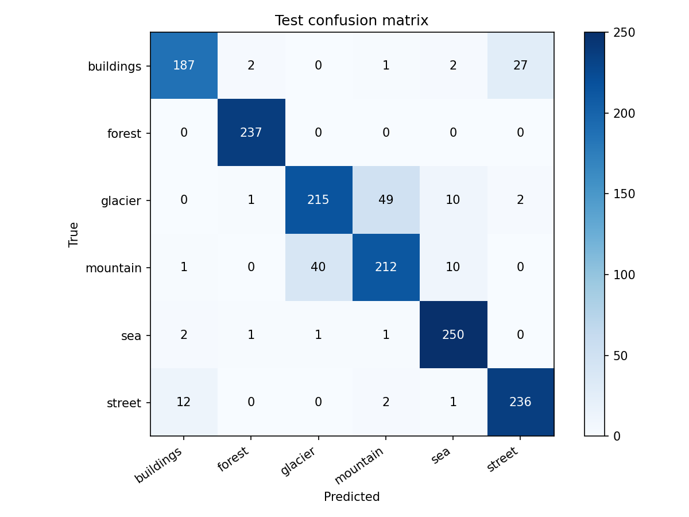
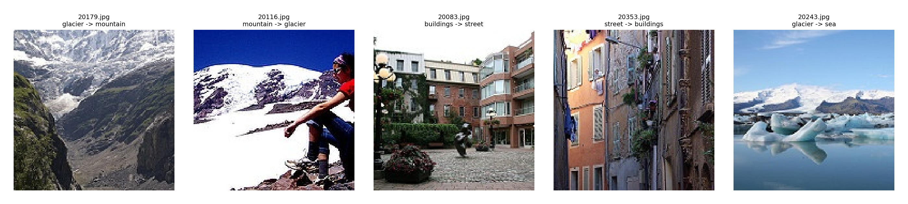

# Лабораторна робота №3

## Мета

Порівняти навчання ResNet-18 з нуля, заморожений ImageNet-кістяк та донавчання layer4
на Intel Image Classification за однакового бюджету 304 кроки.

## Реалізація

- `data.py` - фіксований поділ за іменами файлів, контрольні суми, RGB, перетворення torchvision.
- `model.py` - scratch/frozen/unfreeze, групи AdamW та `set_train_mode()` для заморожування BN.
- `checks.py` - контроль поділу, початкова втрата, кількість параметрів і зміни після п'яти кроків.
- `train.py` - перевірки, рівно сім запусків, журнали та вибір лише за validation після епохи 8.
- `analyze.py` - перевірка хешів і вибраних ваг, таблиці, ефекти та оцінка test на CPU.

У frozen навчається fc (lr=0.003); у unfreeze - fc (0.003) і layer4 (0.0003);
у scratch - вся мережа (0.003). AdamW: weight_decay=0.0001, решта - стандартні значення.
Кожний запуск: 8 епох, train batch=32, validation/test batch=64, float32.
Параметри та BN заморожених модулів мають бути незмінними: одного requires_grad=False недостатньо.

Для кожного режиму `mean_F` - середнє macro-F1, `range_F = max(F) - min(F)`;
`R = max(range_frozen, range_unfreeze)`;
`delta_pre = mean_frozen - F_scratch_seed1`, `delta_unf = mean_unfreeze - mean_frozen`.
Якщо `abs(delta) <= R`, ефект не відрізняється від розкиду.

## Запуск

Команди запускаються з кореня репозиторію в Python 3.12 через [uv](https://docs.astral.sh/uv/).
Аналіз збережених результатів потребує набору зображень та оновлює результати нижче.

```powershell
python download_data.py
uv run --project lab3 python lab3/analyze.py --data data/intel
```

Для повторного навчання задайте нову теку через `--out` і передайте її також аналізу.

```powershell
uv run --project lab3 python lab3/train.py --data data/intel --out work/lab3-rerun
uv run --project lab3 python lab3/analyze.py --data data/intel --out work/lab3-rerun
```

Навчання автоматично використовує CUDA за наявності. Для обчислень на CPU задайте `--device cpu`.
У новій теці будуть власні `split.csv`, журнали, вибрані ваги, графіки й `report.md`.
Збережений `lab3/lab3_model.pt` містить вибрану модель для ЛР4.
Дані та проміжні ваги `runs/*/model.pt` ігноруються Git; журнали, logits і вибрана модель залишаються.
Візуальні пояснення помилок зчитуються з `error_notes.json` у теці відповідного експерименту за іменами файлів.
Невеликі тести протоколу: `uv run --project lab3 python lab3/test_protocol.py`.
У підготовленій локальній копії замість `uv run --project lab3 python` можна використати `.\.venv-labs\Scripts\python.exe`.

## Джерела

[Intel Image Classification](https://www.kaggle.com/datasets/puneet6060/intel-image-classification),
умова ЛР3, лекції 4–7, стандартна ResNet-18 із torchvision та ваги IMAGENET1K_V1.
Для реалізації й пояснень використано OpenAI Codex; результати отримуються локальним виконанням.

<!-- results -->

## Результати

### Перевірки до навчання

| part | class | count | sum | passed |
| --- | --- | --- | --- | --- |
| train | buildings | 200 | 1996761 | так |
| train | forest | 200 | 2032625 | так |
| train | glacier | 200 | 2183923 | так |
| train | mountain | 200 | 1950345 | так |
| train | sea | 200 | 1987613 | так |
| train | street | 200 | 1841817 | так |
| validation | buildings | 218 | 4837323 | так |
| validation | forest | 237 | 5276962 | так |
| validation | glacier | 276 | 6135652 | так |
| validation | mountain | 262 | 5789535 | так |
| validation | sea | 255 | 5655068 | так |
| validation | street | 250 | 5541845 | так |
| test | buildings | 219 | 4837559 | так |
| test | forest | 237 | 5291326 | так |
| test | glacier | 277 | 6157250 | так |
| test | mountain | 263 | 5849765 | так |
| test | sea | 255 | 5668011 | так |
| test | street | 251 | 5547533 | так |

Файли між частинами не перетинаються; всі 18 контрольних клітинок збігаються.



| regime | initial_loss | ln(6) |
| --- | --- | --- |
| scratch | 2.0478852 | 1.7917595 |
| frozen | 1.9243946 | 1.7917595 |

Початкова втрата не мусить дорівнювати ln(6): випадкова голова дає нерівні ймовірності, а розподіли ознак у scratch і frozen різні.

| regime | total | trainable | groups |
| --- | --- | --- | --- |
| scratch | 11179590 | 11179590 | [{'parameters': 11179590, 'lr': 0.003, 'weight_decay': 0.0001}] |
| frozen | 11179590 | 3078 | [{'parameters': 3078, 'lr': 0.003, 'weight_decay': 0.0001}] |
| unfreeze | 11179590 | 8396806 | [{'parameters': 3078, 'lr': 0.003, 'weight_decay': 0.0001}, {'parameters': 8393728, 'lr': 0.0003, 'weight_decay': 0.0001}] |

Режим `frozen` після 5 кроків:

| module | parameters_changed | bn_changed | passed |
| --- | --- | --- | --- |
| conv1 | ні | немає BN | так |
| bn1 | ні | ні | так |
| layer1 | ні | ні | так |
| layer2 | ні | ні | так |
| layer3 | ні | ні | так |
| layer4 | ні | ні | так |
| fc | так | немає BN | так |

Режим `unfreeze` після 5 кроків:

| module | parameters_changed | bn_changed | passed |
| --- | --- | --- | --- |
| conv1 | ні | немає BN | так |
| bn1 | ні | ні | так |
| layer1 | ні | ні | так |
| layer2 | ні | ні | так |
| layer3 | ні | ні | так |
| layer4 | так | так | так |
| fc | так | немає BN | так |

### Навмисна помилка BatchNorm

Прогноз до досліду: При звичайному model.train() параметри замороженого кістяка не зміняться, але running_mean/running_var і num_batches_tracked BN оновляться. Train-loss може спадати, тому сама його крива не виявляє цю помилку.

| module | parameters_changed | bn_changed | passed |
| --- | --- | --- | --- |
| conv1 | ні | немає BN | так |
| bn1 | ні | так | так |
| layer1 | ні | так | так |
| layer2 | ні | так | так |
| layer3 | ні | так | так |
| layer4 | ні | так | так |
| fc | так | немає BN | так |

Максимальні абсолютні зміни layer1.0.bn1: {'running_mean': 0.09283614158630371, 'running_var': 0.12031435966491699}

Train-loss у досліді з помилкою: 1.886961 -> 1.407404. Його спад не показує, що BN кістяка змінився.

Прогноз підтвердився. requires_grad керує градієнтами параметрів, а не буферами BN. У layer4 режиму unfreeze ці буфери мають оновлюватися разом із навчанням стадії.

### Сім запусків

| regime | seed | epoch | train_loss | validation_f1 | seconds |
| --- | --- | --- | --- | --- | --- |
| scratch | 1 | 8 | 0.99267462 | 0.39812618 | 64.571333 |
| frozen | 1 | 8 | 0.16545252 | 0.88420124 | 48.67301 |
| frozen | 2 | 8 | 0.17565552 | 0.87850033 | 46.97225 |
| frozen | 3 | 8 | 0.18958306 | 0.88859557 | 49.054656 |
| unfreeze | 1 | 8 | 0.058838339 | 0.87771623 | 47.553185 |
| unfreeze | 2 | 8 | 0.12223556 | 0.87397227 | 46.849962 |
| unfreeze | 3 | 8 | 0.13379495 | 0.88514286 | 47.416839 |



### Розклад ефектів

| quantity | value |
| --- | --- |
| mean_frozen | 0.88376571 |
| range_frozen | 0.01009524 |
| mean_unfreeze | 0.87894379 |
| range_unfreeze | 0.011170584 |
| R | 0.011170584 |
| delta_pre | 0.48563953 |
| delta_unf | -0.0048219284 |

Попереднє навчання: напрям додатний, величина 48.5640 пунктів macro-F1; R = 1.1171 пунктів; перевищує розкид; вартий перевірки, але не доведений.

Розморожування: напрям від’ємний, величина -0.4822 пунктів macro-F1; R = 1.1171 пунктів; не відрізняється від розкиду; результату немає.

Зерно змінює всі початкові ваги в scratch, лише нову голову у frozen/unfreeze, а також порядок пакетів та аугментації у всіх режимах. Розморожування додає шляхи зміни параметрів і BN, тому розкид може відрізнятися.

R оцінено лише для frozen/unfreeze: розкид scratch за одним запуском невідомий, тому висновок про delta_pre умовний щодо scratch seed=1. Його train-loss: 1.664148 -> 0.992675; validation F1: 0.356877 -> 0.398126.

Максимум validation F1 на кривій scratch за 8 епох: 0.593541; мінімум підсумкових F1 frozen: 0.878500. Це допомагає оцінити відставання в цьому запуску, але не замінює повторів scratch із різними зернами.

Однакові 304 кроки не означають однаковий час: середні секунди {'scratch': 64.57133270000486, 'frozen': 48.2333051666695, 'unfreeze': 47.273328833332926}. Час охоплює цикл восьми епох разом із validation, без завантаження ваг і початкових перевірок.

### Вибір і test

За найбільшим середнім validation macro-F1 вибрано `frozen`, потім найкращий його запуск seed=3. За точних нічиїх використовується порядок scratch, frozen, unfreeze та менше зерно.

Вибір між frozen/unfreeze визначається шумом.

Test macro-F1 = **0.89191262**, validation обраного запуску = **0.88859557**. Різниця test − validation дорівнює +0.00331706. Accuracy = 0.89014647, SE accuracy = 0.00806869 при n=1502. SE accuracy дає лише грубий орієнтир масштабу варіації. Стандартну похибку для macro-F1 не оцінювали.

Вибір найкращого seed може завищувати оцінку validation в середньому. У цьому досліді завищення не спостерігаємо. Через скінченний розмір і різний склад вибірок розрив може змінюватися за розміром і знаком.

| true / predicted | buildings | forest | glacier | mountain | sea | street |
| --- | --- | --- | --- | --- | --- | --- |
| buildings | 187 | 2 | 0 | 1 | 2 | 27 |
| forest | 0 | 237 | 0 | 0 | 0 | 0 |
| glacier | 0 | 1 | 215 | 49 | 10 | 2 |
| mountain | 1 | 0 | 40 | 212 | 10 | 0 |
| sea | 2 | 1 | 1 | 1 | 250 | 0 |
| street | 12 | 0 | 0 | 2 | 1 | 236 |



| file | true | predicted | probability | pair_count | interpretation |
| --- | --- | --- | --- | --- | --- |
| 20179.jpg | glacier | mountain | 0.87724507 | 49 | Ймовірна помилка розмітки: переважають скелясті гірські схили й долина, а виразний льодовик у кадрі не видно. |
| 20116.jpg | mountain | glacier | 0.60069126 | 40 | Сцена містить обидва класи: засніжений гірський схил візуально неоднозначний між mountain і glacier. |
| 20083.jpg | buildings | street | 0.59376103 | 27 | Помилка моделі на однозначному зображенні: головним об'єктом є комплекс будівель навколо внутрішнього двору, який модель сприйняла як street. |
| 20353.jpg | street | buildings | 0.84392369 | 12 | Сцена містить обидва класи: вузька вулиця майже повністю заповнена фасадами будівель. |
| 20243.jpg | glacier | sea | 0.8064788 | 10 | Сцена містить обидва класи: лід і засніжені гори поєднані з великою поверхнею відкритої води, яка нагадує sea. |



Плутанина glacier ↔ mountain є властивістю набору; перерозмітка чи зміна test не виконуються.

### Висновок

За бюджету 304 кроки: delta_pre = 48.5640 п.п., delta_unf = -0.4822 п.п., R = 1.1171 п.п. Інтерпретацію обох ефектів наведено окремо вище. За довшого навчання scratch міг би скоротити відставання.

Для нової задачі з 200 зображеннями на клас почав би з frozen: час 48.2 с і розмах 1.0095 п.п.; виграш unfreeze не перевищує R.

### Відтворюваність

SHA-256 split.csv: `b29c53c7e41b0c4bb36e54d8ca3a9bcbac11eca96abeab8ba4fbcf5937a160b8`. У всіх семи журналах перевірено однаковий хеш. Коміти: ['f5e83777eea1515c4a94d60a54d2c37f86e4f4ee']; наявність незакомічених змін на момент навчання: True.

Python 3.12.10, torch 2.9.0+cu128, torchvision 0.24.0+cu128; навчання NVIDIA GeForce RTX 2070 SUPER, оцінка test CPU. Фіксовані налаштування умови збережено; версії середовища наведено у pyproject.toml, uv.lock і run.json.
